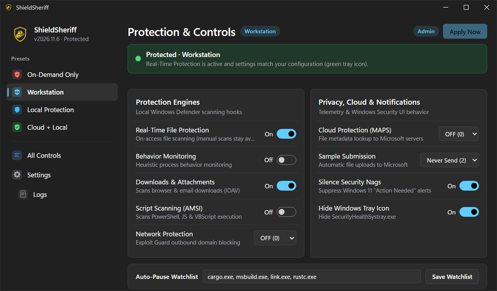

<p align="center">
  
</p>

<h1 align="center">ShieldSheriff</h1>

<p align="center">
  <strong>Granular, Nag-Free Control for Windows 11 Defender.</strong><br />
  <a href="https://kurtisnotcurtis.github.io/shieldsheriff/">Website &amp; Comparison</a> ·
  <a href="https://github.com/kurtisnotcurtis/shieldsheriff/releases">Download Releases</a> ·
  <a href="CLI.md">CLI Reference</a> ·
  <a href="CHANGELOG.md">Changelog</a> ·
  <a href="DEVELOPMENT.md">Developer Guide</a>
</p>

<p align="center">
  
</p>

---

## Why ShieldSheriff?

Windows 11's built-in Microsoft Defender (`MsMpEng.exe`) is a capable local antivirus engine, but its notification layer (`SecurityHealthService.exe` / `SecurityHealthSystray.exe`) relentlessly nags whenever you intentionally turn off **Cloud-delivered protection**, **Automatic sample submission**, **Tamper protection**, or **Real-time protection**—and Windows Updates regularly flip your settings back on.

**ShieldSheriff** is a lightweight (~5 MB), single-binary Windows 11 Defender governor that keeps Defender under your rules using native Windows policies rather than service-killing hacks or fake third-party antivirus registration:

- **Granular Engine Control:** Keep `WinDefend` alive while independently controlling **Real-Time Protection**, **Behavior Monitoring**, **Downloads & Attachments (IOAV)**, **Script Scanning (AMSI)**, **Network Protection**, **Cloud Protection (MAPS)**, and **Sample Submission**.
- **Silence Security Center Nags:** Suppresses Windows Security toast notifications and optionally hides the Windows Security system tray icon (with automatic registry backup and restore).
- **Auto-Heal Update Resets:** Periodically checks your live Defender state (default every 15s, configurable) and restores your chosen settings if a Windows Update or background task resets them.
- **Timed Pause & Auto-Pause on Builds:** Temporarily pause Real-Time Protection for `15m`, `30m`, `1h`, or `4h`, or pause automatically whenever specified compilers, linkers, or games (`cargo.exe`, `msbuild.exe`, `link.exe`, `rustc.exe`, etc.) are running.

---

## Built-In Presets

Choose a one-click preset from the **Dashboard** or **System Tray menu**, or customize every toggle individually:

| Preset | What It Does |
| :--- | :--- |
| **Cloud + Local** | Keeps **Local + Cloud Protection (MAPS) ON**, turns automatic file **Sample Uploads OFF**, and silences all Security Center nags. |
| **Local Protection** *(Default)* | **Local Real-Time &amp; Behavior ON**, Cloud Protection **OFF**, Sample Submission **OFF**, all Windows Security nags **Silenced**. |
| **Workstation** | Keeps core Real-Time scanning ON, turns heavy **Behavior Monitoring** &amp; **Script Scanning** hooks **OFF**, and auto-pauses scanning while `cargo.exe`, `rustc.exe`, `msbuild.exe`, or `link.exe` run. |
| **On-Demand Only** | Turns **Real-Time Protection OFF permanently** (no 24-hour reset) while keeping manual **Quick Scans** and **Definition Updates** working. |

---

## Installation

> **Requirements:** Windows 11 (`x64` or `arm64`). Administrator privileges (UAC) are required to apply Defender policies, run the persistent System Tray, or install the background service.

### Option 1: Install via WinGet
```powershell
winget install kurtisnotcurtis.ShieldSheriff
```
WinGet installs `shiesh.exe` and adds the `shiesh` command alias to your `PATH`.

### Option 2: Portable `.zip` Archive
1. Download `shieldsheriff-<version>-windows-amd64.zip` (or `arm64.zip`) from [GitHub Releases](https://github.com/kurtisnotcurtis/shieldsheriff/releases).
2. Extract `shiesh.exe` into a permanent folder (for example, `C:\Tools\ShieldSheriff\`).
   > **Note for Portable Users:** If you enable **Start in System Tray at Windows Logon** or install the **Background Service**, Windows registers the current path of `shiesh.exe`. Place `shiesh.exe` in its permanent folder before enabling startup/service options.

### One-Time Prerequisite: Turn Off Tamper Protection
Windows Defender's **Tamper Protection** blocks local apps and Group Policy keys from changing Defender settings. Before applying policies for the first time:
1. Open **Windows Security → Virus & threat protection → Manage settings** (or run `start windowsdefender://threatsettings`).
2. Toggle **Tamper Protection** to **Off** once.
3. ShieldSheriff will silence the resulting Tamper Protection warning notification automatically once your configuration is applied.

---

## Getting Started

### 1. Launch the Dashboard & System Tray
Open **ShieldSheriff** from the Start Menu (after WinGet install) or double-click `shiesh.exe` / `ShieldSheriff.lnk`:
- **Safe First Run:** On first launch, ShieldSheriff opens in **Passive / Read-Only** state and reflects your PC's current Defender configuration without changing anything until you click **Admin** (if needed) and **Apply Now**.
- **Windows 11 Native Look:** Uses WebView2 with Windows 11 Mica backdrop and automatically follows your system Dark/Light theme and accent color.
- **Three-State System Tray Icon:**
  - **Preset Mode:** Displays the active preset shield (**Cloud + Local** green checkmark, **Local Protection** blue shield, **Workstation** sky-blue `<>`, **On-Demand Only** red `-`, or **Custom**).
  - **Pause Mode:** Amber shield with `||` pause bars while Real-Time Protection is paused by timer or a watched process.
  - **Passive Mode:** Hollow slate shield outline when ShieldSheriff is not actively enforcing policies.

### 2. CLI & Automation
For scripting, JSON status inspection (`shiesh status --json`), unattended preset application, and service management, see the **[CLI & Automation Reference](CLI.md)**.

---

## Reverting to Windows Defaults & Uninstalling

1. **Revert Defender Policies:** Open the Dashboard or right-click the System Tray icon and select **Passive Mode (Stop Enforcing)** to remove ShieldSheriff's policy locks and restore standard Windows Security notifications.
2. **Remove Background Service / Startup (if enabled):**
   - Turn off **Run at Windows Startup** and click **Remove Service** in the **Settings** tab of the Dashboard (or see [CLI.md](CLI.md)).
3. **Uninstall the Binary:**
   - **WinGet:** `winget uninstall kurtisnotcurtis.ShieldSheriff`
   - **Portable `.zip`:** Delete `shiesh.exe` and optional config folder `C:\ProgramData\ShieldSheriff`.

---

## Versioning, Development & License

- **Calendar Versioning (`CalVer`):** ShieldSheriff uses `YYYY.0M.MICRO` versioning to track Windows 11 cumulative updates and monthly Microsoft Defender platform releases. See [CHANGELOG.md](CHANGELOG.md) and [VERSION.json](VERSION.json).
- **Building from Source & Repo Structure:** See [DEVELOPMENT.md](DEVELOPMENT.md) for the repository layout, architecture internals, and `.\build.ps1` build/test instructions.
- **License:** Released under the [MIT License](LICENSE).
